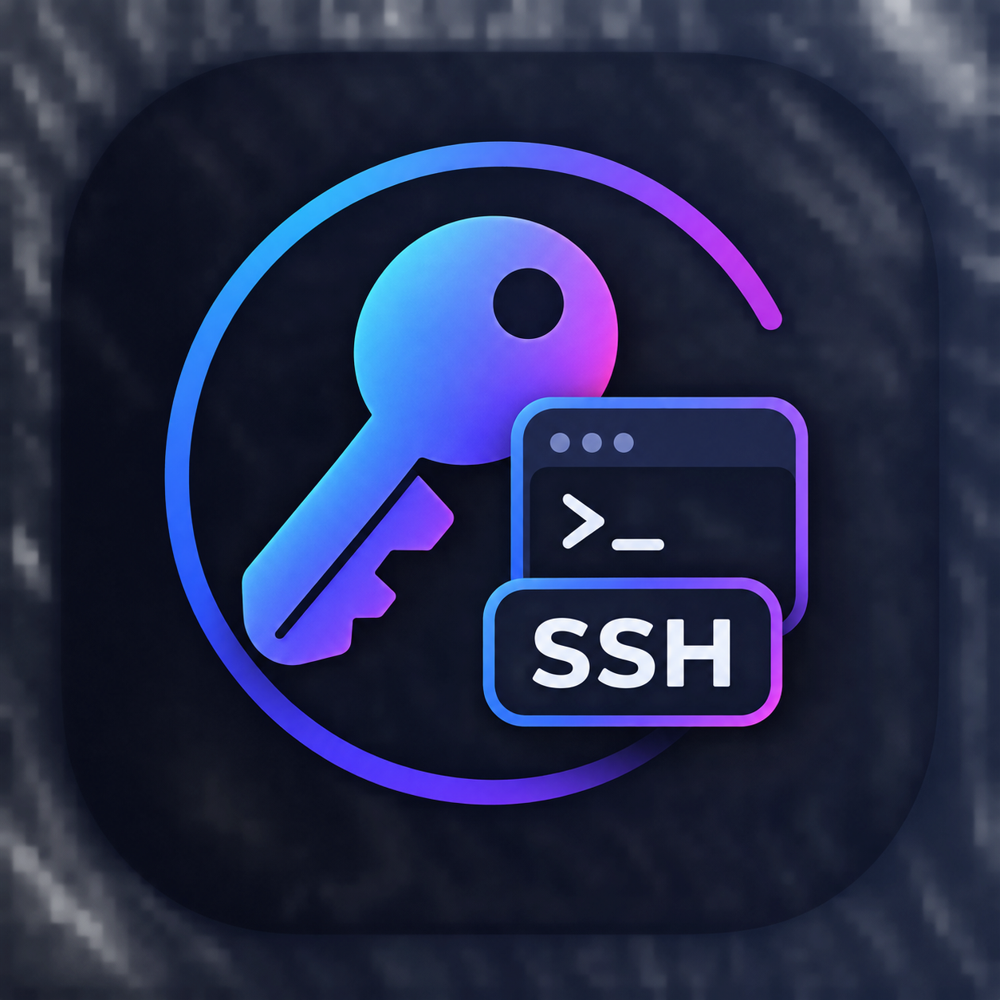

# SSH Key Maker

Програма, яка за один клік створює SSH-ключі. Працює в macOS, Windows 10/11 і Linux
(Electron, тека `electron/`).

Три режими (перемикач угорі вікна):

| Режим | Що робить |
|---|---|
| **Лише ключі (keys)** | Кладе пару ключів у теку `keys` проєкту — далі розміщуєте їх куди потрібно самі |
| **Ключі в ~/.ssh** | Кладе пару ключів у `~/.ssh`, нічого більше не налаштовує |
| **Повне налаштування** | Усе нижче |

У повному режимі програма:

1. створює нову пару SSH-ключів із вашою назвою;
2. дописує сервер у `~/.ssh/config`;
3. показує публічний ключ;
4. сама заливає ключ на сервер;
5. перевіряє вхід за ключем і показує результат **лампочкою**.



---

## Встановлення

| ОС | Команда (з теки проєкту) |
|---|---|
| macOS, Linux | `./start.sh` (або `make start`) |
| Windows | `start.cmd` — подвійним клацанням або з терміналу |

Скрипт перевіряє, чого бракує, і **перед кожним встановленням питає** `[т/Н]`
(«т» або «y» — так, решта — ні):

| Чого бракує | Як встановлюється |
|---|---|
| Node.js 22+ (з ним npm) | macOS — `brew install node` (немає Homebrew — спершу пропонує поставити його); Linux — через nvm у `~/.nvm`, без sudo; Windows — `winget install OpenJS.NodeJS.LTS` |
| Electron | `npm install` у теці `electron/` (~200 МБ, лише перший раз) |
| Бібліотеки для Electron (лише Linux, якщо їх немає) | `apt-get` / `dnf` / `pacman` через sudo |
| OpenSSH | Питає вже сама програма, коли натиснете «Згенерувати» |

Далі скрипт запускає програму. Наступні запуски — та сама команда, вона одразу відкриває вікно.

- `./start.sh -y` / `start.cmd -y` — погодитись на все наперед, без запитань.
- Якщо запустити скрипт не з терміналу (без можливості відповісти) і без `-y` — він нічого не
  ставить і зупиняється.
- Якщо після встановлення Node.js скрипт його не бачить — відкрийте новий термінал і запустіть знову.

## Як користуватись

| Поле | Що вписати | Приклад |
|---|---|---|
| **Назва** | Коротке ім'я сервера латиницею. Під ним будете підключатись (`ssh erp`) і ним названо файли ключа | `erp` |
| **Хост** | IP-адреса або домен сервера | `176.103.114.151` |
| **Порт** | Порт SSH на сервері | `9522` |
| **Користувач** | Ваш логін на сервері | `root` |
| **Пароль сервера** | Пароль цього логіна — потрібен **один раз**, щоб залити ключ. Ніде не зберігається | |
| **Пароль ключа** | Необов'язково. Захищає ключ, якщо ноутбук потрапить до чужих рук. Ключ додається в агент; macOS ще й запам'ятає пароль у «Зв'язці ключів» | |

У режимах «Лише ключі» та «Ключі в ~/.ssh» потрібні тільки **Назва** й (за бажання) **Пароль ключа**.
Рядок **Куди:** під формою показує, куди ляже ключ.

Натисніть **Згенерувати** (або Enter) і стежте за лампочкою:

| Лампочка | Значення |
|---|---|
| ⚪ сіра | Очікує |
| 🟡 жовта | Виконується |
| 🟢 зелена | Готово — вхід за ключем працює (у режимах лише ключів — «Ключі створено») |
| 🔴 червона | Помилка — причина в журналі внизу вікна |

Після зеленої лампочки підключайтесь у терміналі так:

```bash
ssh erp
```

Кнопки біля публічного ключа:

- **Копіювати** — кладе публічний ключ у буфер, наприклад щоб надіслати адміністратору іншого
  сервера чи додати в GitLab;
- **Показати у Finder** (у Windows і Linux — **Показати в теці**) — відкриває теку з ключами й
  виділяє приватний ключ.

## Що програма створює

| Що | Де |
|---|---|
| Приватний ключ (нікому не передавати) | `~/.ssh/id_ed25519_<назва>` (у режимі «Лише ключі» — `keys/id_ed25519_<назва>`) |
| Публічний ключ | `~/.ssh/id_ed25519_<назва>.pub` (або `keys/…pub`) |
| Захист від git | `keys/.gitignore` — щоб приватні ключі випадково не закомітити |
| Новий запис у кінці конфігу | `~/.ssh/config` |
| Резервна копія конфігу перед правкою | `~/.ssh/config.bak-<дата>` |
| Ваш ключ на сервері | `~/.ssh/authorized_keys` на сервері |

У Windows `~/.ssh` — це `%USERPROFILE%\.ssh`.

Запис у конфігу виглядає так:

```
Host erp
    HostName 176.103.114.151
    Port 9522
    User root
    IdentityFile ~/.ssh/id_ed25519_erp
    IdentitiesOnly yes
    AddKeysToAgent yes
    IgnoreUnknown UseKeychain
    UseKeychain yes
```

Два останні рядки (`IgnoreUnknown`, `UseKeychain`) пишуться лише в macOS.

## Безпека

- Наявний ключ із такою самою назвою **не перезаписується** — програма зупиниться.
- Повторний запис `Host` з тією ж назвою **не додається** — програма зупиниться.
- Пароль сервера передається в `ssh` не через командний рядок і стирається з вікна після роботи.
- Відбиток нового сервера приймається автоматично (лише для сервера, якого ще немає в
  `known_hosts`). Відбиток, що **змінився**, програма не приймає — це помилка в журналі.
- Нічого не встановлюється без вашої згоди.

## Якщо бракує програм

Програма використовує стандартні команди OpenSSH: `ssh-keygen`, `ssh-copy-id`, `ssh`, `ssh-add`
(для режимів лише ключів досить `ssh-keygen`). Якщо котрої немає — програма **спитає** й встановить:

| ОС | Як |
|---|---|
| macOS | `brew install openssh`. Немає Homebrew — запропонує відкрити Термінал з командою його встановлення |
| Linux | `apt-get` / `dnf` / `pacman` / `zypper` через `pkexec` (система спитає пароль) |
| Windows | Компонент «OpenSSH Client» (`Add-WindowsCapability`), Windows спитає права адміністратора |

У Windows `ssh-copy-id` немає — ключ заливається через `ssh` (сервер має бути Linux/Unix).
Якщо в журналі попередження від `ssh-add`, увімкніть службу «OpenSSH Authentication Agent».

## Якщо лампочка червона

| У журналі | Що робити |
|---|---|
| `Permission denied` під час заливання | Невірний користувач чи пароль сервера |
| `Connection timed out` / `refused` | Невірний хост чи порт, або вашу IP-адресу не пущено на сервер |
| `REMOTE HOST IDENTIFICATION HAS CHANGED` | Сервер перевстановили або це не той сервер. Перевірте, потім видаліть старий запис: `ssh-keygen -R "[хост]:порт"` |
| `уже існує` | Оберіть іншу назву |
| Ключ залито, але перевірка не пройшла | На сервері може бути вимкнено вхід за ключем (`PubkeyAuthentication`) або неправильні права на `~/.ssh` |

Якщо невдало пройшов лише останній крок — ключ і запис у конфігу вже створені. Щоб почати
спочатку, видаліть два файли ключа й блок `Host` з `~/.ssh/config` (або поверніть резервну копію).

## Для розробника

```bash
make          # те саме, що make start
make start    # за згодою поставити Node.js та Electron і запустити
make icons    # перегенерувати іконки з icon.png
make clean    # прибрати встановлений Electron (electron/node_modules)
make help     # список команд
```

Код лежить у `electron/`: `main.js` — уся логіка, `index.html` + `renderer.js` — вікно.
Без скрипта її можна запустити так: `cd electron && npm install && npm start`.

Щоб змінити іконку — замініть `icon.png` (квадрат) і виконайте `make icons` (потрібна macOS:
`sips`). Іконки лягають у `icons/` (вікно Electron бере `icons/hicolor/512x512/…`):

| Платформа | Файл |
|---|---|
| Windows | `icons/icon.ico` |
| Linux | `icons/hicolor/<розмір>/apps/ssh-key-maker.png` + `icons/ssh-key-maker.desktop` |

Повний опис логіки, щоб переписати програму іншою мовою чи під іншу ОС, — у `AGENTS.md`.
